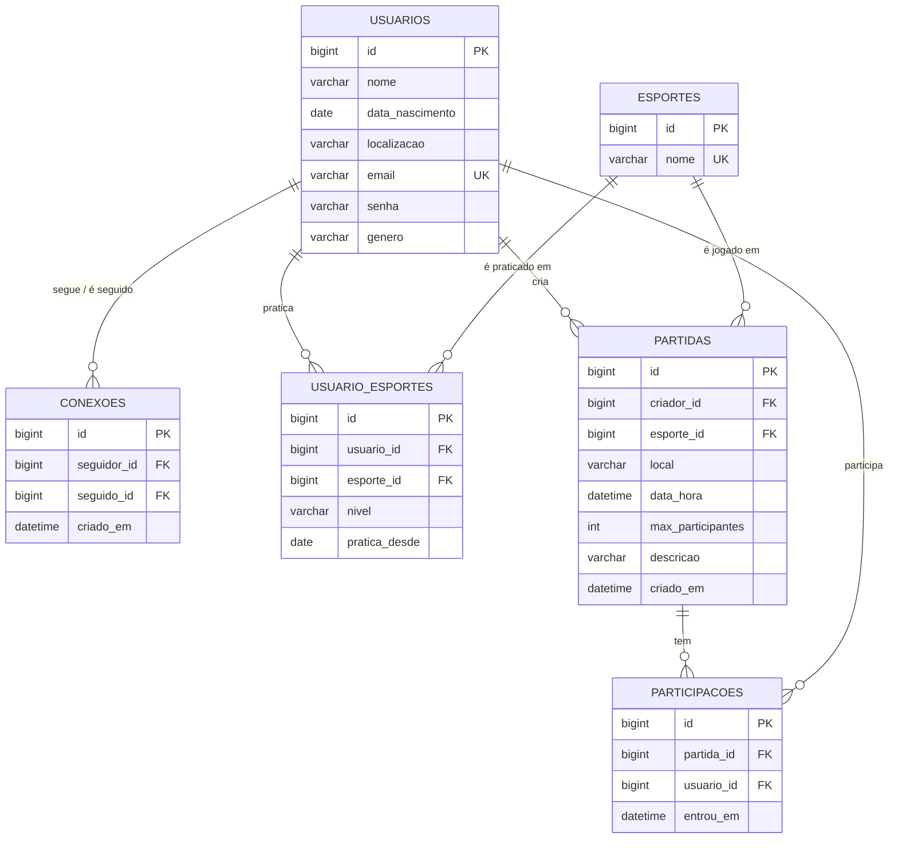

# ⚽ Encontro Esportes

> API REST para encontrar parceiros e fechar times para praticar esportes.


## 💡 Motivação

Para uma partida completa de futebol são necessárias 12 pessoas - e reunir todo esse pessoal costuma ser a parte mais difícil. Durante a graduação, eu e meus colegas vivíamos tentando fechar time, e quase sempre faltava gente.

O **Encontro Esportes** nasceu desse problema: um app onde as pessoas montam um perfil com os esportes que praticam, seguem outros jogadores e criam ou entram em partidas com vagas limitadas.

## 🚧 Status do projeto

O **backend** está em desenvolvimento ativo. Os módulos de **perfil, busca, conexões e esportes** estão completos, e o módulo de **partidas** está na metade. O front-end, a conteinerização e o deploy fazem parte do [roadmap](#-roadmap).

## 🛠️ Tecnologias

- **Java 21**
- **Spring Boot 4.1** (Spring Web MVC, Spring Data JPA, Bean Validation)
- **Hibernate** (ORM)
- **MySQL 8.4**
- **Lombok**
- **Maven**
- **Postman** (testes manuais da API)

## ✅ Funcionalidades

**Perfil e busca**
- [x] Cadastro de usuário com validação dos campos (e-mail único, senha com número e símbolo)
- [x] Ver, atualizar e excluir perfil
- [x] Busca de usuários com filtros combináveis: nome, gênero, faixa de idade, localização e esporte

**Conexões**
- [x] Seguir e deixar de seguir usuários
- [x] Remover um seguidor
- [x] Listar quem o usuário segue e quem o segue

**Esportes do perfil**
- [x] Catálogo de esportes carregado automaticamente ao iniciar a aplicação
- [x] Adicionar esportes ao perfil com nível (iniciante, intermediário, avançado) e data de início
- [x] Listar e remover esportes do perfil

**Partidas**
- [x] Criar partida (o criador entra automaticamente como participante)
- [x] Entrar em partida com controle de vagas (sem inscrição duplicada e sem partidas que já aconteceram)
- [x] Sair de partida (o criador não pode sair)
- [x] Cancelar partida (apenas o criador)
- [ ] Listar minhas partidas
- [ ] Página inicial com as partidas de quem eu sigo
- [ ] Lista de inscritos de uma partida

## 🗂️ Modelo de dados



As tabelas `conexoes`, `usuario_esportes` e `participacoes` são **entidades de associação**: em vez de um `@ManyToMany`, cada uma é uma entidade própria com dois `@ManyToOne`, o que permite guardar dados da relação (data da conexão, nível no esporte, data de entrada na partida). Todas têm restrição de unicidade no par de chaves estrangeiras.

## 📡 Endpoints

**Usuários**

| Método | Rota | Descrição | Sucesso |
|---|---|---|---|
| `POST` | `/usuarios` | Cadastrar usuário | `201` |
| `GET` | `/usuarios/{id}` | Ver perfil | `200` |
| `PUT` | `/usuarios/{id}` | Atualizar perfil | `200` |
| `DELETE` | `/usuarios/{id}` | Excluir conta (remove também conexões e esportes) | `204` |
| `GET` | `/usuarios?nome=&genero=&idadeMin=&idadeMax=&localizacao=&esporteId=&usuarioId=` | Buscar usuários (todos os filtros são opcionais) | `200` |

**Conexões**

| Método | Rota | Descrição | Sucesso |
|---|---|---|---|
| `POST` | `/usuarios/{usuarioId}/seguindo/{seguidoId}` | Seguir usuário | `201` |
| `DELETE` | `/usuarios/{usuarioId}/seguindo/{seguidoId}` | Deixar de seguir | `204` |
| `DELETE` | `/usuarios/{usuarioId}/seguidores/{seguidorId}` | Remover seguidor | `204` |
| `GET` | `/usuarios/{usuarioId}/seguindo` | Listar quem o usuário segue | `200` |
| `GET` | `/usuarios/{usuarioId}/seguidores` | Listar seguidores | `200` |

**Esportes**

| Método | Rota | Descrição | Sucesso |
|---|---|---|---|
| `GET` | `/esportes` | Listar catálogo de esportes | `200` |
| `POST` | `/usuarios/{usuarioId}/esportes` | Adicionar esporte ao perfil | `201` |
| `GET` | `/usuarios/{usuarioId}/esportes` | Listar esportes do perfil | `200` |
| `DELETE` | `/usuarios/{usuarioId}/esportes/{esporteId}` | Remover esporte do perfil | `204` |

**Partidas**

| Método | Rota | Descrição | Sucesso |
|---|---|---|---|
| `POST` | `/usuarios/{usuarioId}/partidas` | Criar partida | `201` |
| `DELETE` | `/usuarios/{usuarioId}/partidas/{partidaId}` | Cancelar partida (só o criador) | `204` |
| `POST` | `/partidas/{partidaId}/participantes/{usuarioId}` | Entrar em partida | `201` |
| `DELETE` | `/partidas/{partidaId}/participantes/{usuarioId}` | Sair de partida | `204` |

> ℹ️ Por enquanto o usuário que executa a ação é identificado pelo `usuarioId` na URL. Com a implementação do Spring Security (ver [roadmap](#-roadmap)), ele passará a ser identificado pelo login.

**Exemplo — criar partida**

```http
POST /usuarios/2/partidas
Content-Type: application/json

{
  "esporteId": 1,
  "local": "Quadra da UEM - Bloco 5",
  "dataHora": "2026-12-05T19:00:00",
  "maxParticipantes": 12,
  "descricao": "Racha da quadra R$10"
}
```

```json
{
  "id": 1,
  "criadorId": 2,
  "criador": "Cleiton",
  "esporteId": 1,
  "esporte": "Futebol",
  "local": "Quadra da UEM - Bloco 5",
  "dataHora": "2026-12-05T19:00:00",
  "maxParticipantes": 12,
  "participantes": 1,
  "descricao": "Racha da quadra R$10"
}
```

**Formato dos erros**

```jsonc
// 400 — validação dos campos
{ "local": "A localização é obrigatória", "maxParticipantes": "A partida deve ter no mínimo dois participantes" }

// 404 / 409 / 403 — regras de negócio
{ "erro": "Essa partida está lotada." }
```

## 🧠 Decisões técnicas

- **Arquitetura em camadas** (`controller` → `service` → `repository`): os controllers só recebem e respondem requisições; as regras de negócio ficam nos services.
- **DTOs com `record`**: as entidades nunca são expostas diretamente. Isso impede, por exemplo, que a senha apareça em alguma resposta, e permite ter DTOs diferentes para cadastro e atualização (o e-mail e a senha não são alterados pelo `PUT`).
- **Tratamento global de erros** com `@RestControllerAdvice`: validação, regras de negócio, parâmetros com tipo inválido e JSON malformado sempre retornam um JSON limpo e com o status HTTP correto, sem expor stack traces.
- **Status HTTP semânticos**: `201` ao criar, `204` ao remover, `400` para dados inválidos, `403` para falta de permissão, `404` para recurso inexistente e `409` para conflitos (e-mail já cadastrado, inscrição duplicada, partida lotada).
- **Busca com filtros opcionais em uma única consulta JPQL**, usando o padrão `(:filtro IS NULL OR ...)`. O filtro por esporte usa `EXISTS` em vez de `JOIN`, para que um usuário com vários esportes não apareça repetido.
- **Integridade dos dados em duas camadas**: o service verifica as regras e retorna erros amigáveis, e o banco garante as mesmas regras com `UNIQUE` e chaves estrangeiras.
- **`@Transactional` em operações com várias escritas** (excluir conta, criar e cancelar partida): ou todas as alterações acontecem, ou nenhuma.

## ▶️ Como rodar

**Pré-requisitos:** Java 21 e MySQL 8.

1. Crie o banco de dados:
   ```sql
   CREATE DATABASE encontro_esportes;
   ```
2. Defina a senha do MySQL na variável de ambiente `DB_PASSWORD` (o usuário padrão é `root`, configurado em `backend/src/main/resources/application.yaml`).
3. Na pasta `backend`, execute:
   ```bash
   ./mvnw spring-boot:run
   ```
   No Windows: `mvnw.cmd spring-boot:run`
4. A API estará disponível em `http://localhost:8080`. As tabelas são criadas automaticamente e o catálogo de esportes é carregado pelo `data.sql`.

## 🗺️ Roadmap

- [x] Planejamento (épicos e histórias de usuário com critérios de aceitação — ver [`PLANEJAMENTO.md`](PLANEJAMENTO.md))
- [x] Perfil de usuário, validação e tratamento de erros
- [x] Busca com filtros
- [x] Conexões entre usuários
- [x] Esportes do perfil
- [ ] Partidas (em andamento)
- [ ] Front-end responsivo (HTML, CSS e JavaScript)
- [ ] Conteinerização com Docker e Docker Compose
- [ ] Deploy
- [ ] CI/CD com GitHub Actions (testes automatizados e deploy contínuo)
- [ ] Autenticação e autorização com Spring Security

## 👤 Autor

**Davi Bozolla**

[](https://github.com/DaviBozolla)
<!-- Adicione seu LinkedIn: [](https://www.linkedin.com/in/SEU-USUARIO) -->
